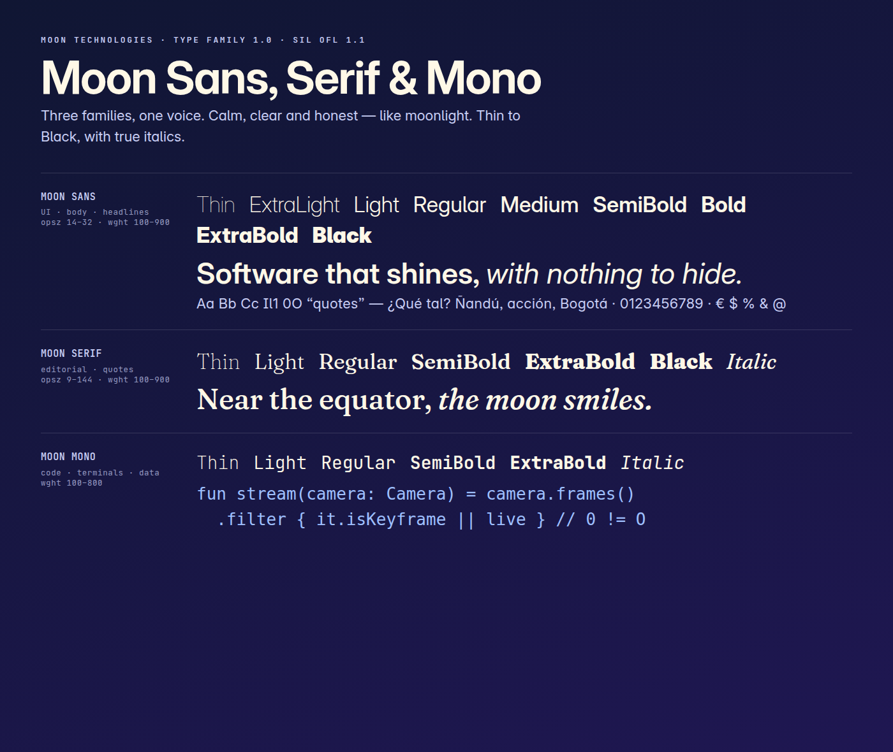

# Moon Type Family

**Moon Sans · Moon Serif · Moon Mono** — the typefaces of Moon Technologies.
Free under the [SIL Open Font License 1.1](OFL.txt).

| Family | For | Weights | Styles |
|---|---|---|---|
| **Moon Sans** | Interfaces, text, headlines | Thin 100 → Black 900 | Roman + Italic |
| **Moon Serif** | Editorial headlines, quotes | Thin 100 → Black 900 | Roman + Italic |
| **Moon Mono** | Code, terminals, data | Thin 100 → ExtraBold 800 | Roman + Italic |

## Install

**Linux:** `mkdir -p ~/.local/share/fonts/moon && cp fonts/static/*/*.ttf ~/.local/share/fonts/moon/ && fc-cache -f`
**Windows / macOS:** open the files in `fonts/static/` and click **Install**.
**Web:** use the variable WOFF2 files in `fonts/webfonts/`.

`fonts/variable/` has every weight in one file; `fonts/static/` has one file per weight and style.

Derived from Inter, Fraunces and JetBrains Mono (SIL OFL 1.1). © 2026 Moon Technologies.
